KOMPACS má tři části: IRIS for Health, API a webové UI. IRIS drží veškerý stav. API je v produkci bezstavové.

```mermaid
flowchart LR
  subgraph SRC["Zdroje"]
    NIS["NIS / RIS"]
    PACS["PACS"]
    INS["Výpis pojišťovny"]
  end
  subgraph STACK["Sada KOMPACS"]
    subgraph IRIS["IRIS for Health"]
      direction TB
      PROD["Produkce"] --> FHIR[("FHIR R4")] --> SQL[("SQL + vektory")]
    end
    API["API"]
    WEB["Webové UI"]
    MCP["pacs-mcp"]
  end
  subgraph OUT["Uživatelé, klienti"]
    USER(["Koordinátor, lékař"])
    AGENT(["MCP klient"])
    LLM["EU LLM"]
  end
  NIS -->|HL7| IRIS
  PACS -->|CSV| IRIS
  INS --> API
  IRIS <--> API
  IRIS --> MCP
  API --> WEB
  WEB --> USER
  MCP --> AGENT
  API --> LLM
```

| Komponenta | Technologie | Role |
|---|---|---|
| IRIS for Health | InterSystems IRIS for Health | Úložiště FHIR R4, příjem HL7 a CSV, SQL projekce, vektorové vyhledávání |
| API | Python, FastAPI | Sestaví případ, volá AI, zapisuje žádosti a souhrny |
| Webové UI | React, TypeScript | Pohled koordinátora a lékaře, česky |
| `pacs-mcp` | Python, FastMCP | Nástroje MCP nad FHIR a vektory IRIS |
| LLM | Model v EU Data Zone | Hledá zmínky ve zprávách, posuzuje relevanci |

## Škálování

- API je bezstavové. Lze spustit N replik.
- IRIS drží stav. Pro vysokou dostupnost licencovaný IRIS se zrcadlením.
- Jedna sada na nemocnici. Data pacientů mezi sadami neputují.

Dále: [Tok dat](/cs/explanation/data-flow/).
