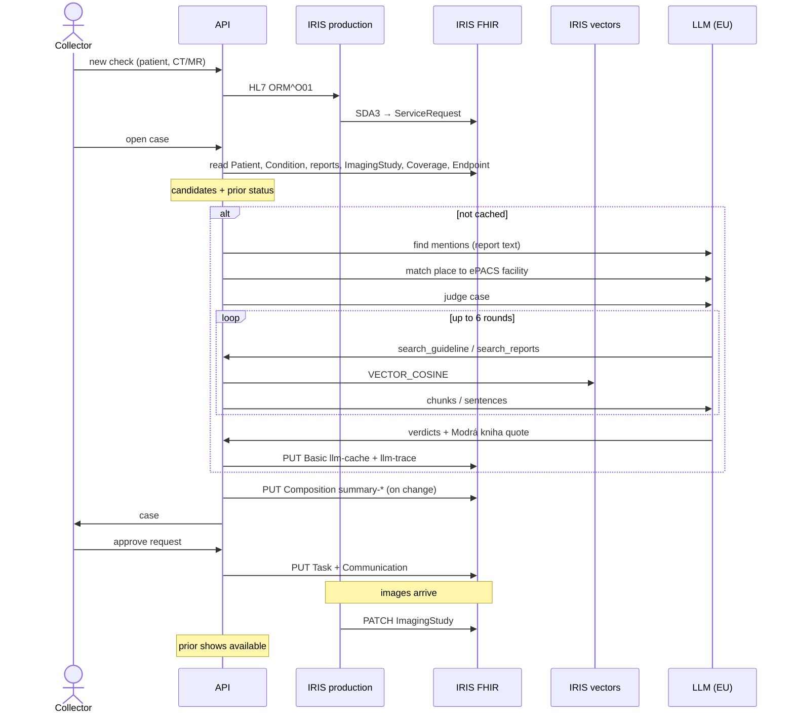
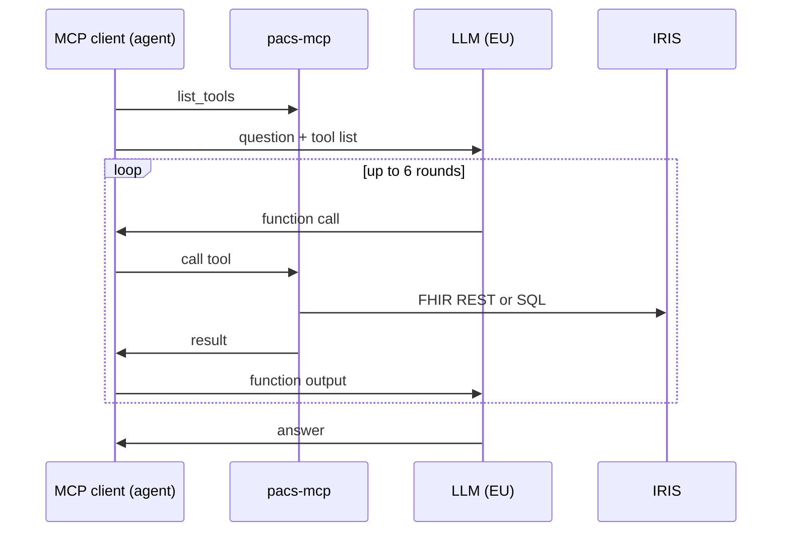

## Processes

| # | Process | Starts with | Path |
|---|---|---|---|
| 1 | Load | Setup | FHIR bundles → FHIR. Guideline PDF → vectors. Report sentences → vectors. |
| 2 | Trigger | HL7 order or MDT list | HL7 ORM^O01 → production → SDA3 → `ServiceRequest` |
| 3 | Case build | Collector opens a case | API reads FHIR → candidates and status → LLM → `Task`, `Composition` |
| 4 | Collector actions | Click in the UI | Review → `Basic`. Approve → `Task` + `Communication`. Re-judge → `Basic`. |
| 5 | Images arrive | PACS feed row | CSV → production → PATCH `ImagingStudy` |
| 6 | Search | Patient picker, timeline | Picker: SQL on `pacs.*`. Timeline: vector search. |
| 7 | MCP Q&A | MCP client question | Agent ↔ LLM. Agent runs `pacs-mcp` tools → FHIR and SQL. |

## Sources

| Origin | Content |
|---|---|
| Dataset | Pseudonymized FHIR bundles and a PACS availability CSV from the hackathon |
| Simulated | HL7 orders, MDT list, other hospitals, insurer statement data. FHIR tag `simulated`. |
| Public | Modrá kniha ČOS PDF, ePACS facility directory |
| Derived | Everything KomPACS writes: verdicts, requests, summaries |

## One check

## MCP question

The LLM never calls MCP. The agent is the MCP client. `pacs-mcp` reads the `Composition` that the API wrote.

## What leaves IRIS

| Call | When | Sends |
|---|---|---|
| Find mentions | Case build, per report not yet cached | Text and date of one report |
| ePACS match | New place name in a report | Place name and 15 facility names |
| Judge case | Case build, re-judge | Case JSON. Tool results: guideline chunks, the patient's report sentences. |
| MCP agent | A question | Question. Tool results: FHIR resources, case summary, report sentences. |

Patient text goes only to an EU Data Zone model. The API refuses other models. Embeddings run on a local model in the API container, so report text goes to no embedding service.

## Stores

| Store | Data | Written by |
|---|---|---|
| FHIR, dataset | Patient, Condition, reports, ImagingStudy | Loader, PACS feed (status) |
| FHIR, trigger | ServiceRequest, MDT List | HL7 production, API |
| FHIR, derived | Requests, verdicts, summaries, ePACS organizations | API |
| Insurer statement server | ExplanationOfBenefit, Coverage | Seed (POC) |
| `pacs.*` SQL | Patient, Condition | FHIR SQL Builder, live |
| `vec.ReportSentence` | Report sentence vectors, no text | API |
| `vec.GuidelineChunk` | Modrá kniha chunks and vectors | Setup |
