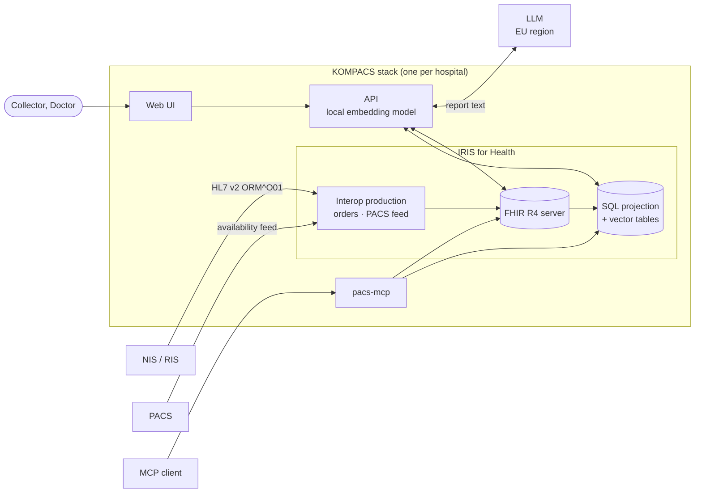

KOMPACS has three parts: IRIS for Health, an API and a web UI. IRIS holds all state. The API is stateless in production.

## Components

| Component | Technology | Role |
|---|---|---|
| IRIS for Health | InterSystems IRIS for Health | FHIR R4 store, HL7 and CSV ingest, SQL projection, vector search |
| API | Python, FastAPI | Builds cases, calls the AI judge, writes requests and summaries |
| Web UI | React, TypeScript | Collector and Doctor views, in Czech |
| `pacs-mcp` | Python, FastMCP | MCP tools over FHIR and IRIS vectors |
| LLM | EU Data Zone model | Finds mentions in report text, judges relevance |

## IRIS features in use

| Need | IRIS feature |
|---|---|
| Store patient data as FHIR | Built-in FHIR R4 server |
| HL7 v2 orders to FHIR | Interop production: HL7 → SDA3 → FHIR |
| PACS CSV to FHIR | Interop production with embedded Python, FHIR PATCH |
| SQL over FHIR | FHIR SQL Builder projection, live |
| Find priors in report text | `VECTOR` columns, HNSW index, `VECTOR_COSINE`, `EMBEDDING()` |
| Audit trail | FHIR `_history` on `Composition` and `Basic` |
| Second FHIR server | Insurer statement mock on the same instance |

## Scale

- The API is stateless. Run N replicas.
- IRIS holds all state. For high availability, use a licensed IRIS with mirroring.
- One stack per hospital. No patient data crosses stacks.
- Central services hold no patient data: the verified-contact directory of hospitals.

Next: [Data flow](/explanation/data-flow/).
