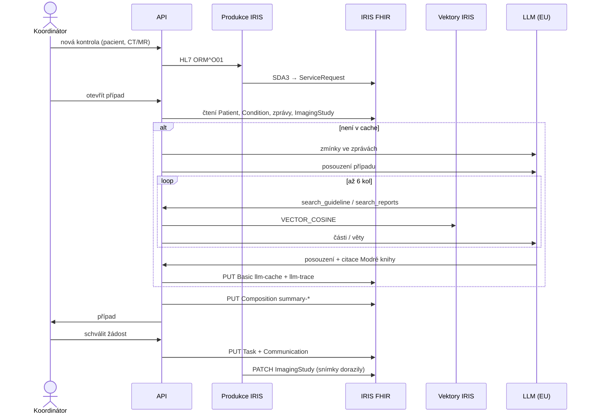

## Jedna kontrola

## Co opouští IRIS

| Volání | Kdy | Posílá |
|---|---|---|
| Hledání zmínek | Sestavení případu | Text a datum jedné zprávy |
| Párování s ePACS | Nové místo ve zprávě | Název místa a 15 názvů zařízení |
| Posouzení případu | Sestavení, nové posouzení | JSON případu, části doporučení, věty ze zpráv |
| MCP agent | Dotaz | Dotaz a výsledky nástrojů |

Text o pacientovi jde jen do modelu v EU Data Zone. Embeddingy počítá lokální model v kontejneru API.

Úplné tabulky procesů a úložišť: [anglická verze](/en/explanation/data-flow/).
